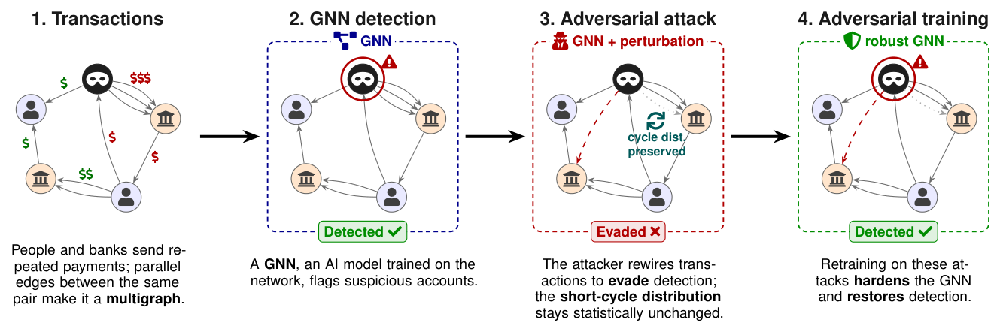

# Towards Adversarially Robust Multigraph Neural Networks for Financial Crime Analysis

**Dennis Heijmans\*, H. Çağrı Bilgi\*, Rui Wang, Kubilay Atasu**
Delft University of Technology · \*equal contribution

*Learning on Graphs Conference (LoG 2026), Proceedings of Machine Learning Research (PMLR)*

[Paper](#) <!-- TODO: add the PMLR / OpenReview / arXiv link --> · [BibTeX](#citation)



## Summary

Money launderers can try to hide by rerouting their transactions. This repository contains the code to attack graph neural networks for anti-money laundering (AML) by rewiring transactions in a multigraph, to keep such rewiring plausible with a cycle-based regularizer, and to defend the models with adversarial training.

**Abstract.** Financial transaction networks are naturally represented as multigraphs, where repeated transactions between the same pair of accounts are modeled as distinct edges. Recently proposed multigraph neural network architectures leverage this structure explicitly to achieve a strong performance on anti-money laundering (AML) tasks. However, their robustness to adversaries that manipulate transaction structures to evade detection remains largely unexplored. We present the first scalable framework for structural attacks and adversarial training of multigraph neural networks using node-edge incidence matrices, adapting projected gradient descent and projected randomized block coordinate descent methods to optimize structural perturbations over such matrices. We further introduce a cycle-based regularizer that penalizes changes in the global counts of directed 2- and 3-cycles, providing a targeted measure of structural plausibility. Experiments on synthetic pattern-detection and realistic AML datasets show that our learned attacks substantially outperform non-learnable perturbation baselines in reducing detection performance (PR-AUC), while adversarial training consistently improves robustness against these attacks. These results demonstrate that multigraph neural networks are vulnerable to learned structural attacks and that adversarial training provides an effective defense.

## Repository structure

```
main.py                      # entry point: python main.py <task> <config.json>
config/
  subgraph_pattern_detection/  # synthetic experiments (00–06)
  aml/train/                   # AML standard and adversarial training
  aml/attack/                  # AML attacks (unconstrained and criminal threat model)
experiments/                 # task drivers: train, attack, adv_train, adv_train_multigin
robust_multignn/
  attacks/                     # uniform, PGD, PR-BCD (synthetic and AML), cycle regularizer
  models/                      # multigraph GIN (MultiGIN), MultiPNA
  synthetic/                   # synthetic pattern-detection data generator
  aml/                         # IBM AML data loading and preprocessing
  ports_cpp.cpp                # C++ extension for port numbering
analysis/scripts/            # plotting scripts for the synthetic figures
tests/                       # unit tests and CPU smoke tests
docs/                        # notes on the PR-BCD AML attack implementation
```

## Installation

Tested on Linux (Ubuntu under WSL2) with conda; native Windows is not supported (the code uses the Unix-only `resource` module). Building the C++ extension needs a C++ compiler (`g++`).

**GPU (as used for the paper; CUDA 12.1):**

```bash
git clone https://github.com/denheijmans/robust_multignn.git
cd robust_multignn
conda env create -f environment.yml
conda activate robust-mgnn
pip install -e . --no-build-isolation
```

**CPU only (enough for the smoke tests):**

```bash
conda env create -f environment-cpu.yml
conda activate robust-mgnn-cpu
pip install -e . --no-build-isolation
```

`--no-build-isolation` is required because `setup.py` imports `torch` to compile the `robust_multignn_ports_cpp` extension.

**Check the installation** (CPU, about 20 s, no data or W&B account needed):

```bash
pytest tests
```

`tests/test_smoke_pipeline.py` runs training, the uniform and PR-BCD attacks with the cycle regularizer, and adversarial training end to end, on a small generated graph and on a random CSV in the IBM AML format.

> Verified: the CPU installation and `pytest tests` from a fresh clone. The GPU environment file resolves with conda, but was not installed on a GPU for this release.

## Data

All data goes under `data/` (configurable with `data_dir` in each config).

| | Synthetic pattern detection | IBM Transactions for AML |
|---|---|---|
| Source | Generated by this code, using the generator of [IBM/Graph-Pattern-Generator](https://github.com/IBM/Graph-Pattern-Generator) | [Kaggle: IBM Transactions for Anti Money Laundering (AML)](https://www.kaggle.com/datasets/ealtman2019/ibm-transactions-for-anti-money-laundering-aml) |
| Paper | Egressy et al., AAAI 2024 | Altman et al., NeurIPS 2023 (Datasets and Benchmarks) |
| License | Generator code: Apache 2.0 | CDLA-Sharing-1.0 |
| Obtain | Nothing to download | Download from Kaggle (account required) |
| Expected files | `data/subgraph_pattern_detection/seed_0.pt` (created automatically) | `data/Small_HI/HI-Small_Trans.csv`, `data/Small_LI/LI-Small_Trans.csv`, `data/Medium_HI/HI-Medium_Trans.csv`, `data/Medium_LI/LI-Medium_Trans.csv` |

**Synthetic data.** The first run of any synthetic config generates the dataset and caches it. Each of the train/validation/test graphs is a directed multigraph with 8,192 nodes and average degree 6 (`GraphSimulator`, `network_type="type1"`, `generator="chordal"`, `delta=11.1`; see `robust_multignn/synthetic/generator.py`). Nodes carry 11 binary labels: in/out-degree and fan-in/out above 3, membership in directed 2- to 6-cycles, scatter-gather and biclique patterns. All configs use `data_seed: 0`.

> The synthetic dataset used in the paper was generated with a seed derivation that depended on Python's per-process hash randomization and could not be recovered. This release generates the data deterministically, so rerunning gives a dataset from the same distribution, but not the identical graphs, and the synthetic numbers will differ slightly from the paper.

**IBM AML data.** The paper uses the Small and Medium variants with high (HI) and low (LI) illicit ratios; the Large variants and the `*_Patterns.txt` files are not used. Put each CSV in its own folder as listed above. Preprocessing runs automatically on the first run for a dataset: it writes `formatted_transactions.csv` (numerically encoded transactions) and a `data.pt` cache next to the CSV, and splits transactions by day into train/validation/test (target 60/20/20). Expect several GB of RAM and disk for the Medium variants.

## Usage and reproducing the results

```bash
python main.py <task> <config.json> [--device cpu] [--dryrun] [--index i] [--project name]
```

`<task>` is `train`, `attack`, `adv_train` or `adv_train_multigin`. A config value given as a list is a grid, and the run executes every combination; `--index i` runs only the i-th combination (e.g. for job arrays), `--count` prints the number of combinations.

**Weights & Biases is required to reproduce the results.** Trained models are stored as W&B artifacts and are loaded by name by the attack and adversarial-training tasks, and the plotting scripts read results from W&B. Run `wandb login` first; runs are logged to the project `robust_multignn` of your default entity (change with `--project`). `--dryrun` disables W&B, which is fine for training on its own, but then no model is saved for later attacks.

The configs set `"device": "cuda:0"`; pass `--device cpu` to run on CPU. All experiments in the paper were run on a single GPU; we did not record per-experiment runtimes.

### Synthetic pattern detection

Run in this order (each config runs 3 seeds):

```bash
python main.py train              config/subgraph_pattern_detection/00_train_multigin.json
python main.py attack             config/subgraph_pattern_detection/01_uniform_attack_multigin.json
python main.py attack             config/subgraph_pattern_detection/03_prbcd_attack_multigin.json
python main.py attack             config/subgraph_pattern_detection/04_cycle_loss_weight_sweep.json
python main.py adv_train_multigin config/subgraph_pattern_detection/05a_adv_train_multigin.json  # with cycle regularizer (λ=0.05)
python main.py adv_train_multigin config/subgraph_pattern_detection/05b_adv_train_multigin.json  # without
python main.py attack             config/subgraph_pattern_detection/06a_attack_adv_train_multigin.json
python main.py attack             config/subgraph_pattern_detection/06b_attack_adv_train_multigin.json
```

| Paper item | Runs | Plot |
|---|---|---|
| Fig. 3 – PR-AUC drop per pattern, PR-BCD vs. uniform | `01`, `03` | `python -m analysis.scripts.plot_attack_robustness_scatter` |
| Fig. 4 – cycle regularizer weight trade-off | `04` | `python -m analysis.scripts.plot_lambda_tradeoff` |
| Fig. 5 – adversarially trained models | `05a` → `06a` | `python -m analysis.scripts.plot_adv_training_cleveland` |
| Fig. D.2 – adversarial training without the cycle regularizer | `05b` → `06b` | same script on the `05b`/`06b` runs |
| Fig. D.1 – per-pattern PR-AUC vs. budget | `03` | `python -m analysis.scripts.plot_robustness_cleveland` |
| Tab. D.1 – with vs. without cycle regularizer at 10% | `06a`, `06b` at 10% | no script; mean ± std over 3 model × 3 attack seeds |
| Tab. C.1 – positive-class ratios | logged when the dataset is loaded | — |

*Verified for this release:* `train` with `--dryrun --device cpu` (1 epoch), `--count`, and that the plotting modules import. `attack`, `adv_train` and `adv_train_multigin` need the W&B model artifacts, so they were run only through the equivalent code path in `tests/test_smoke_pipeline.py`, not from the command line.

The plotting scripts select W&B runs by tag (`attack effectiveness plot`, `weight sweep plot`, `robustness plot`), so add the matching `"wandb_tags"` entry to the configs before running them, and they write to `analysis/figures/`. Fetched runs are cached in `analysis/.cache/`; pass `--refresh-cache` to refetch. *The plotting scripts were not re-run for this release, because they need access to the W&B runs.*

### IBM AML

Standard training, then attacks; adversarial training starts from the standard model (`init_artifact`):

```bash
python main.py train     config/aml/train/aml_multigin_train_hi.json        # Small HI; _li, MedHI, MedLI analogously
python main.py adv_train config/aml/train/aml_adv_multigin_train_hi.json    # PR-BCD at 5%, unconstrained
python main.py attack    config/aml/attack/small_hi/multigin_prbcd.json      # PR-BCD on the standard model
python main.py attack    config/aml/attack/small_hi/multigin_uniform.json    # uniform rewiring baseline
python main.py attack    config/aml/attack/small_hi/multigin_prbcd_adv.json  # on the adversarially trained model
python main.py attack    config/aml/attack/small_hi/criminal/multigin_prbcd.json  # criminal threat model
```

| Paper item | Configs | Notes |
|---|---|---|
| Fig. 6 – criminal threat model, Small HI/LI | `train/aml_multigin_train_{hi,li}`, `attack/small_{hi,li}/criminal/*` | Covers the standard model. The configs for criminal-threat-model adversarial training (ρ = 20%) and the plotting script are not included. |
| Fig. E.1 – unconstrained threat model, Small/Medium × HI/LI | `train/*multigin*`, `attack/{small,medium}_{hi,li}/multigin_{prbcd,uniform}[_adv]` | Plotting script not included. |
| Fig. E.2 – MultiPNA | `train/aml_multipna_train_{hi,li}` | The MultiPNA model and its standard training are included. The attack runs used an extended experiment pipeline that is not part of this release. |
| Tab. C.2 – AML dataset statistics | — | Node/edge counts, illicit ratio and split are printed when a dataset is loaded. |

*Verified for this release:* preprocessing and `train` (MultiGIN and MultiPNA, `--dryrun --device cpu`, 1 epoch) on a small random CSV in the IBM format. The real Kaggle data and full-scale runs were not run. `attack` and `adv_train` were run only through `tests/test_smoke_pipeline.py`.

The reduced PR-BCD budget in the appendix (20 samples, 30 steps, 10 block resamples, block 512 × 400,000 / 512 × 1,300,000) is the attack used *inside* adversarial training (`config/aml/train/aml_adv_*`). The evaluation attacks use the settings in `config/aml/attack/`.

### Methods in the code

- **Attacks:** `robust_multignn/attacks/` – `uniform` (random rewiring baseline), `pgd` (projected gradient descent), `prbcd` (projected randomized block coordinate descent), and `aml` (PR-BCD and uniform for edge-level AML, including the criminal threat model). Selected by `attack_type`. PGD is implemented but not used in the configs for the paper's experiments.
- **Cycle regularizer:** `robust_multignn/attacks/regularizers.py`, enabled with `"regularizer_terms": {"cycle_loss": λ}` in `attack_params`.
- **Adversarial training:** `experiments/experiment_adv_train_multigin.py` (synthetic) and `experiments/experiment_adv_train.py` (AML).

## Citation

```bibtex
@inproceedings{heijmans2026towards,
  title     = {Towards Adversarially Robust Multigraph Neural Networks for Financial Crime Analysis},
  author    = {Heijmans, Dennis and Bilgi, H. {\c{C}}a{\u{g}}r{\i} and Wang, Rui and Atasu, Kubilay},
  booktitle = {Proceedings of the Learning on Graphs Conference (LoG 2026)},
  series    = {Proceedings of Machine Learning Research},
  volume    = {TODO},
  pages     = {TODO},
  publisher = {PMLR},
  year      = {2026},
  url       = {TODO}
}
```

Please also cite the datasets:

```bibtex
@inproceedings{altman_realistic_2023,
  title     = {Realistic synthetic financial transactions for anti-money laundering models},
  booktitle = {{NeurIPS}},
  author    = {Altman, Erik and Blanu{\v s}a, Jovan and Von Niederh{\"a}usern, Luc and Egressy, B{\'e}ni and Anghel, Andreea and Atasu, Kubilay},
  year      = {2023}
}

@inproceedings{egressy_provably_2024,
  title     = {Provably powerful graph neural networks for directed multigraphs},
  booktitle = {{AAAI}},
  author    = {Egressy, B{\'e}ni and Von Niederh{\"a}usern, Luc and Blanu{\v s}a, Jovan and Altman, Erik and Wattenhofer, Roger and Atasu, Kubilay},
  year      = {2024}
}
```

## License

This code is released under the [Apache License 2.0](LICENSE). <!-- TODO: confirm the license with the co-authors before publishing. -->
`robust_multignn/synthetic/simulator.py` is adapted from [IBM/Graph-Pattern-Generator](https://github.com/IBM/Graph-Pattern-Generator), and parts of `robust_multignn/aml/` from [IBM/Multi-GNN](https://github.com/IBM/Multi-GNN), both under Apache 2.0. The IBM AML dataset is licensed separately under CDLA-Sharing-1.0.

## Acknowledgements

The support of the Swiss National Science Foundation (project number: 212158) for this work is gratefully acknowledged. Research reported in this work was partially facilitated by computational resources and support of the Delft AI Cluster (DAIC) at TU Delft (RRID: SCR\_025091), but remains the sole responsibility of the authors, not the DAIC team.
